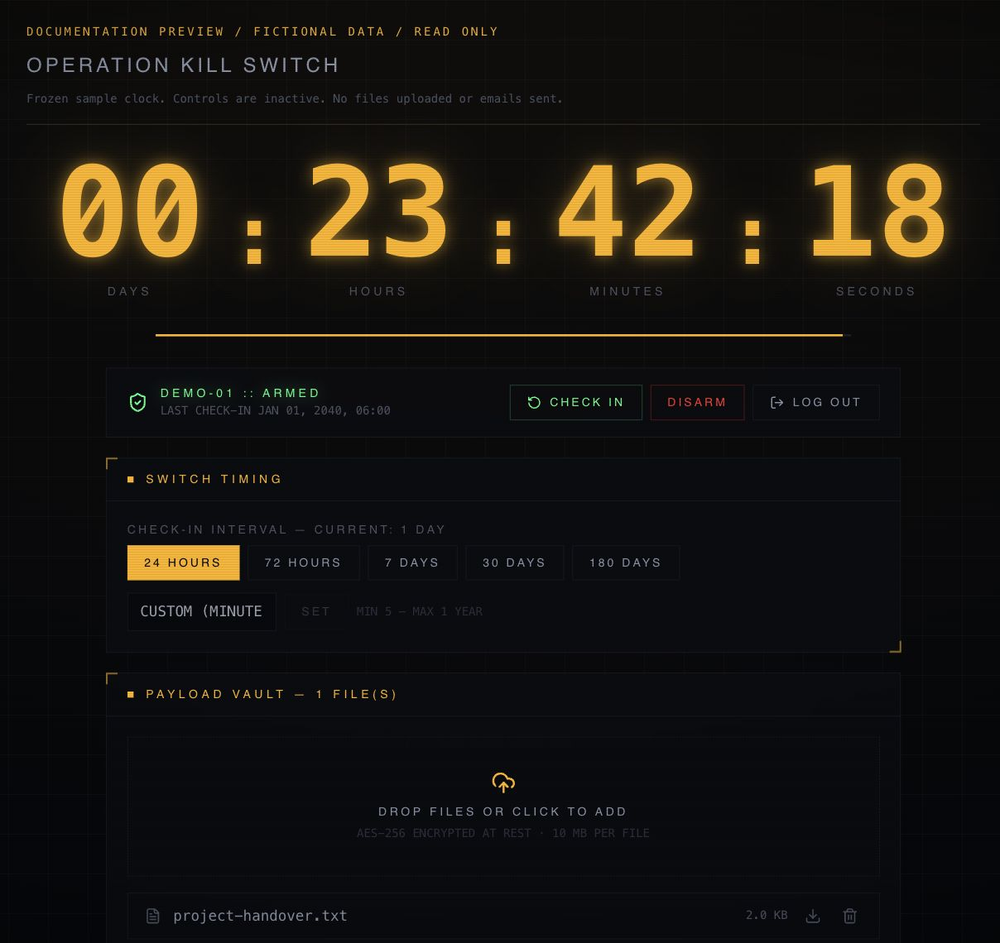
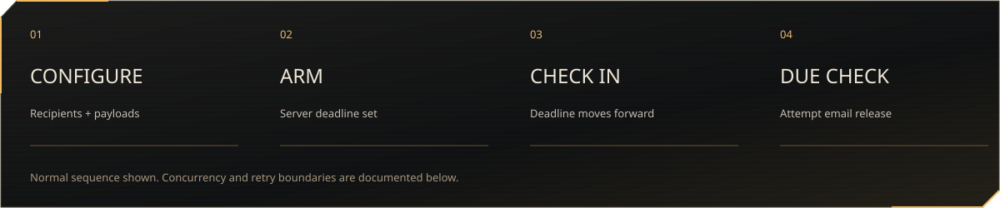

<picture>
  <source media="(prefers-reduced-motion: reduce) and (max-width: 640px)" srcset="readme-assets/cover-mobile-still.svg">
  <source media="(prefers-reduced-motion: reduce)" srcset="readme-assets/cover-still.svg">
  <source media="(max-width: 640px)" srcset="readme-assets/cover-mobile.svg">
  
</picture>

# Operation Kill Switch

**Set the deadline. Keep checking in. Define what happens next.**

A multi-user dead man's switch for timed file handover. An operator configures recipients, uploads a payload, and arms a deadline. Checking in moves that deadline forward. If it passes, a scheduled backend worker attempts to release the files by email.

I designed and built the application across the operator experience, authentication and approval flow, encrypted file handling, database model, and scheduled delivery. The interface treats time as the central interaction; the backend owns the decision to act.

**[Explore the engineering ↓](#behind-the-switch)** · [Preview the console](#preview-the-console) · [Read the delivery model](docs/ENGINEERING.md#delivery-and-concurrency)

`React 18` · `TypeScript` · `Vite` · `Supabase` · `PostgreSQL` · `Resend`


## Every action has a consequence

A large countdown anchors the console. Timing presets, payload files, recipient directives, and identity settings sit beneath it. Arming, checking in, and disarming are explicit actions. An approval workflow separates account creation from access to switch and file operations.



*Local read-only capture, November 14, 2026. Fictional operator, file metadata, and dates; inactive controls. No live account or delivery activity is shown.*



The normal path is **configure → arm → check in → extend**, with an overdue release when check-ins stop. A reminder is attempted during the final 10% of the interval. The scheduler runs every minute; the browser's seconds display is not the delivery trigger.


## Behind the switch


### Four decisions worth opening the code for

**1. Identity is enforced where the work happens.** `user-api` validates the session with Supabase Auth, derives the user ID from that identity, and scopes file operations to it. Account approval and administrator checks run on the server. The hidden admin route is navigation, not an authorization boundary. [Inspect the API →](supabase/functions/user-api/index.ts)

**2. File upload is a multi-step operation.** The API validates base64 and size before decoding, sanitizes names, encrypts bytes with AES-GCM and a fresh IV, then writes to private storage. If the metadata insert fails, it attempts to remove the uploaded object. This addresses the failure between storage and database writes. [Follow upload and download →](supabase/functions/user-api/index.ts)

**3. Delivery has a resource budget.** A release limits aggregate attachments to 25 MiB and names skipped files in the email. Each switch is processed inside its own error boundary so a thrown error does not stop the rest of the batch. [Trace the worker →](supabase/functions/check-switch-multi/index.ts)

**4. Throttling survives individual requests.** Action limits use a database-backed limiter; its failure denies the operation. Delivery tests are capped at three per hour and ten per day per operator. [Inspect the API and database hardening →](supabase/migrations/20260905_security_hardening.sql)

### The important boundary

Encryption is **server-side**, with keys held by the backend; outgoing files are ordinary email attachments. Delivery is not exactly-once: the current worker has no atomic claim or idempotency key, and a concurrent check-in or disarm can race its snapshot. Provider acceptance and the final state update are separate operations. The [engineering notes](docs/ENGINEERING.md) explain these tradeoffs and the next reliability work explicitly.

### Find the implementation

| Concern | Source |
| :--- | :--- |
| Session, approval states, public wall, admin routing | [`src/App.tsx`](src/App.tsx) |
| Operator controls and countdown presentation | [`Console.tsx`](src/components/Console.tsx), [`Countdown.tsx`](src/components/Countdown.tsx) |
| Authenticated actions, uploads, downloads, administration | [`user-api`](supabase/functions/user-api/index.ts) |
| Signup, invites, and public feed | [`wall`](supabase/functions/wall/index.ts) |
| Scheduled reminders and release | [`check-switch-multi`](supabase/functions/check-switch-multi/index.ts) |
| Schema, policies, scheduler, rate limits | [`supabase/migrations/`](supabase/migrations/) |

## Preview the console

The documentation preview renders the real console components with frozen fixture data and inactive controls. It needs no Supabase account and sends no email.

```bash
git clone https://github.com/cojovi/operation_killswitch.git
cd operation_killswitch
npm ci
VITE_SUPABASE_URL=http://127.0.0.1:9 \
VITE_SUPABASE_ANON_KEY=preview-only-not-a-credential \
VITE_TURNSTILE_SITE_KEY='' \
npm run dev -- --host 127.0.0.1 --port 5179 --strictPort
```

Open **http://127.0.0.1:5179/docs/preview.html**. The entry checks the disconnected configuration before loading the console. This is a visual walkthrough, not a backend simulator. For a working integration environment, follow the [operations guide](docs/OPERATIONS.md); the main application needs an explicitly configured, isolated backend.

## Verification

The frontend production build and explicit TypeScript project checks passed on **November 14, 2026**. Lint completed with one existing Fast Refresh warning. There is no automated regression suite in this revision; these checks do not validate deployed functions, database policies, scheduled delivery, or inbox receipt. [Full verification record →](docs/SHOWCASE_VERIFICATION.md)

```bash
npx tsc -b --pretty false
npx tsc -p docs/tsconfig.preview.json --pretty false
npm run lint
npm run build
```

## Further reading

[Engineering & failure model](docs/ENGINEERING.md) · [Development & operations](docs/OPERATIONS.md) · [Historical security notes](SECURITY.md) · [Still artwork](readme-assets/cover-still.svg)


**Designed and built by [COJOVI](https://github.com/cojovi).**

[More work ↗](https://cojovi.com) · [GitHub profile ↗](https://github.com/cojovi)
