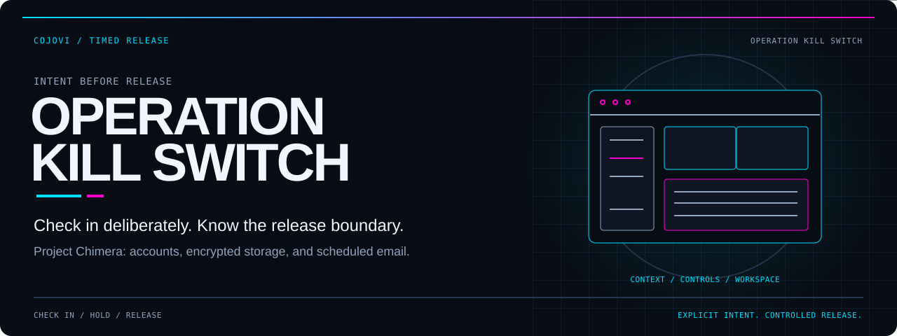
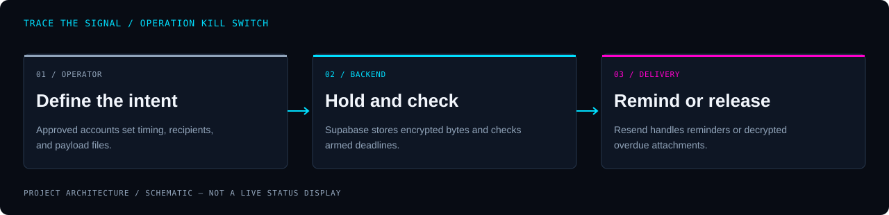

<!-- COJOVI / SIGNAL — Project Chimera / Operation Kill Switch project edition. Keep readme-assets/ with this file. -->
<a name="top"></a>

<p align="center">
  
</p>

<h1 align="center">Operation Kill Switch</h1>

<p align="center">
  <strong>Set the interval. Keep checking in. Define what happens at the deadline.</strong><br>
  Project Chimera's multi-user dead man's switch: a React console backed by Supabase timers, encrypted storage, and email delivery.
</p>

<p align="center">
  
</p>

<p align="center">
  <a href="#overview">Overview</a> ·
  <a href="#architecture">Architecture</a> ·
  <a href="#quickstart">Preparation</a> ·
  <a href="#configuration">Configuration</a> ·
  <a href="#usage">Operation</a> ·
  <a href="#security">Security</a>
</p>

---

<a name="overview"></a>
## `> meet_the_switch`

**Operation Kill Switch lets an approved account manage a timed release of uploaded files.** Operators configure recipients and a check-in interval, upload payloads, and explicitly arm a switch. Backend checks can send a reminder near the deadline and release the payload if the deadline passes.

The repository remains [cojovi/project_chimera](https://github.com/cojovi/project_chimera); its current package name and visible product identity are `operation-kill-switch`. This README describes the reviewed **`main` source**, which contains the multi-user, signup-gated application despite older branch descriptions calling `main` single-user.

| Check in | Hold a payload | Control access |
| :--- | :--- | :--- |
| Reset a server-recorded deadline; explicitly arm or disarm. | Encrypt file bytes server-side before private storage, then decrypt for authorized retrieval or release. | Use Supabase Auth, invite/manual approval, and an administrator review panel. |

> [!IMPORTANT]
> **This is an application with real external effects, not an offline timer demo.** Opening an unconfigured frontend can use a committed backend fallback. Scheduled checks and delivery tests can send email. Prepare an isolated backend before running a copy; never use the existing deployment as a development sandbox.

<a name="architecture"></a>
## `> trace_the_deadline`

<p align="center">
  
</p>

```text
React console + Supabase Auth
       ↓ session JWT
user-api → profiles / switches / user_payload_files
       └→ AES-GCM encryption → private payload bucket

pg_cron → check-switch-multi → due-state inspection
       ├→ final-10% reminder → Resend
       └→ overdue: decrypt attachments → Resend → triggered state

Public landing → wall → permitted real timers + mock timers
```

The frontend talks to `wall` and `user-api` through [api.ts](src/lib/api.ts). `user-api` validates the session with Supabase Auth and scopes user operations by identity. Public feed requests expose approved, wall-visible armed or triggered switches and separately marked mock timers.

The [multi-user migration](supabase/migrations/20260801_chimera_multiuser.sql) schedules `chimera-check-multi` every minute. This is not a browser countdown callback or exact-to-the-second delivery guarantee. Edge functions are deployed separately from the Vite bundle; legacy `switch-api` and `check-switch` code remains alongside the multi-user implementation.

<a name="quickstart"></a>
## `> prepare_a_copy`

**Start with Git and a source review.** Frontend development later needs Node.js/npm compatible with Vite 5; no Node engine is pinned. A functioning system also requires a separately prepared Supabase project and a permitted email-delivery environment.

### 1. Clone the reviewed branch

```bash
git clone --branch main https://github.com/cojovi/project_chimera.git
cd project_chimera
```

### 2. Establish isolation before starting the frontend

1. Review [supabase.ts](src/lib/supabase.ts) and override **both** backend variables with your own project settings. Do not rely on their committed fallbacks.
2. Review all [migrations](supabase/migrations/) in order, including legacy dependencies, seeded identities, invite data, and embedded cron destinations. Adapt a private working copy; do not blindly apply them to an existing project.
3. Prepare required tables, private storage, Vault secrets, Auth settings, and edge functions in the isolated project. Plan administrator bootstrap explicitly rather than retaining source-specific account seeds.
4. Keep delivery schedulers disabled while preparing the system, and leave switches disarmed. Use only synthetic files and controlled recipient addresses during a separately authorized test.
5. Align edge-function CORS, frontend environment settings, and hosting CSP with the isolated project.

There is no complete offline simulator or verified one-command backend bootstrap in this repository. Deployment notes are historical operational guidance, not proof of the state of your new environment.

### 3. Configure the frontend privately

Create an ignored `.env.local`. The following values are **nonfunctional placeholders**, not credentials or a usable backend:

```dotenv
VITE_SUPABASE_URL=https://YOUR_PROJECT.supabase.co
VITE_SUPABASE_ANON_KEY=YOUR_PUBLIC_ANON_KEY
# Optional; pair with the backend TURNSTILE_SECRET configuration.
VITE_TURNSTILE_SITE_KEY=YOUR_PUBLIC_SITE_KEY
```

Review [env.example](env.example), but do not copy existing project settings blindly. Browser-exposed `VITE_*` values must never contain service-role credentials or encryption secrets.

### 4. Preview only after isolation is ready

```bash
npm install
npm run dev -- --host 127.0.0.1 --port 5173 --strictPort
```

The source CORS allowlist includes loopback development on port 5173. The explicit host and strict port avoid an all-interface preview or silent port change. A loopback frontend **still calls its configured remote backend**.

<a name="configuration"></a>
## `> set_the_boundaries`

| Layer | Required review |
| :--- | :--- |
| Browser client | `VITE_SUPABASE_URL`, `VITE_SUPABASE_ANON_KEY`; optional `VITE_TURNSTILE_SITE_KEY`. |
| Edge runtime | `SUPABASE_URL` and `SUPABASE_SERVICE_ROLE_KEY`; keep privileged values server-side. |
| Vault | `ENCRYPTION_KEY`, `CRON_SECRET`, `RESEND_API_KEY`, `FROM_EMAIL`; optional `TURNSTILE_SECRET`. |
| Database | Profiles, switches, file registry, invites, rate-limit helpers, RLS, and function grants. |
| Storage | Private `payload` bucket; multi-user objects use `multi/<user_id>/…`. |
| Scheduler | Adapt cron destinations and secret headers; retain intended legacy/multi-user boundaries. |
| Hosting | [vercel.json](vercel.json) contains security headers and project-specific CSP destinations. |

Turnstile is conditional: the frontend widget requires its site key, and server enforcement begins when `TURNSTILE_SECRET` is present in Vault. Configure both together. Signup uses `email_confirm: true`, so account creation is not an email-ownership verification round trip.

Function comments specify gateway `verify_jwt: false`; `user-api` performs its own JWT check and scheduled handlers check `x-cron-secret`. Preserve and review those authentication boundaries rather than treating CORS or a hidden frontend route as authorization.

<a name="usage"></a>
## `> operate_deliberately`

The intended workflow, after a separately verified deployment:

1. **Create an account or sign in.** A valid invite approves signup; no invite creates a pending account; an invalid invite is rejected.
2. **Wait for clearance if needed.** Pending or denied accounts cannot use the protected switch/file actions. Configuration access remains available within the backend's allowlist.
3. **Set recipients and timing.** Select an interval, email subject/message, and any CC recipients. Review wall visibility and callsign separately.
4. **Upload authorized content.** Payload bytes are encrypted by the server, not end-to-end encrypted from the browser.
5. **Arm explicitly.** Arming requires an approved account and a recipient. Check-in resets the deadline; disarm stops the armed-state release path.
6. **Administer carefully.** Administrators use `#/command` for account review and invite management; server-side checks enforce admin access.

| Limit or behavior | Implemented boundary |
| :--- | :--- |
| Uploads | Up to 20 files per user; 10 MiB per file. |
| Release attachments | 25 MiB aggregate cap; excess files are skipped and named in the release message. |
| Timing | API accepts 5–527040 minutes; the UI offers presets and a custom interval. |
| CC recipients | Up to 10 addresses. |
| Delivery test | Sends actual mail; limited to 3/hour and 10/day per operator. |
| Reminder | Attempted in the final 10% of the interval when no reminder is recorded for that cycle. |

The release handler sends before recording `triggered`. Provider acceptance, database updates, concurrent invocations, and failures are not an atomic transaction: **do not assume exactly-once delivery or guaranteed receipt**. A successful provider response is not confirmation that a human received every attachment.

<a name="validation"></a>
## `> verify_in_isolation`

The frontend manifest provides:

```bash
npm run lint
npm run build
npm run preview -- --host 127.0.0.1
```

`build` runs `tsc && vite build`; it does not deploy or validate Supabase functions, database migrations, cron, or email delivery. Preview is not a backend sandbox, and its origin must be accounted for in CORS before connecting it.

**Application builds and tests were not run for this documentation work.** No GitHub Actions workflow or npm test script is tracked. The security probe makes network requests and attempts operations expected to be denied; it is not a documentation-only check.

- [ ] Confirm frontend, functions, cron URLs, CSP, and CORS all target the isolated project.
- [ ] Review migration seeds and explicitly provision the first administrator.
- [ ] Verify RLS and function grants, including inherited `PUBLIC` permissions.
- [ ] Verify signup approval, denied accounts, ownership checks, and admin boundaries.
- [ ] Confirm Turnstile settings and email-ownership assumptions.
- [ ] Use synthetic payloads to verify encryption/decryption and attachment limits.
- [ ] Plan failure, retry, duplicate-delivery, and key-recovery behavior before real use.
- [ ] Authorize any later scheduler or mail test separately; inspect results and recipient consent.

<a name="source-map"></a>
## `> explore_the_source`

| Path | Responsibility |
| :--- | :--- |
| [App.tsx](src/App.tsx) | Session, public feed, approval states, and admin hash route. |
| [AuthPanel.tsx](src/components/AuthPanel.tsx) | Login, gated signup, and optional Turnstile widget. |
| [Console.tsx](src/components/Console.tsx) | Timing, file, recipient, identity, and passphrase controls. |
| [wall](supabase/functions/wall/index.ts) | Public feed, signup, invite handling, and signup throttles. |
| [user-api](supabase/functions/user-api/index.ts) | Authenticated user/admin actions and encrypted file operations. |
| [check-switch-multi](supabase/functions/check-switch-multi/index.ts) | Reminder/release processing and attachment cap. |
| [migrations](supabase/migrations/) | Legacy and multi-user schemas, scheduled jobs, and hardening. |
| [SECURITY.md](SECURITY.md) | Historical findings and owner follow-up, not a fresh certification. |

<a name="security"></a>
## `> protect_the_payload`

Server-side encryption protects stored file bytes, but the backend holds the key and decrypts for downloads and outgoing email. Recipients receive ordinary attachments; the design is **not end-to-end encryption**. Review plaintext metadata, public callsign/timer visibility, mail retention, and key backup before using sensitive material.

Historical security notes identify exposed credentials and a legacy password needing owner remediation. Do not assume deletion or history rewriting revokes a credential. Verify remediation privately without copying values into issues or documentation.

Do not run `cleanup.sh` or `purge-env-from-history.sh` as setup checks: they perform destructive cleanup or history rewriting. Preserve `chimera` database/job identifiers where existing integrations depend on them. Switching Git branches does not isolate a shared backend.

### Identity and license

This is the **Project Chimera / Operation Kill Switch** repository, not a fork according to GitHub metadata. Existing branch tables and comments predate the reviewed `main` contents; inspect a chosen revision rather than assuming a branch name establishes its application version.

**No root license file was found.** Public source availability does not establish blanket redistribution rights; clarify terms with the owner and preserve dependency notices.

---

<p align="center">
  
</p>

<p align="center">
  <strong>Explicit intent. Private payloads. Accountable release.</strong><br>
  <sub>A <a href="https://github.com/cojovi">Cody / cojovi</a> project · <a href="https://cojovi.com">cojovi.com</a><br>
  Project Chimera / Operation Kill Switch · Presented in COJOVI / SIGNAL.</sub>
</p>

<p align="center"><a href="#top">↑ Back to the signal</a></p>
